# NEXUS Database Schema Reference

NEXUS uses a relational database model implemented with SQLAlchemy 2.0 ORM and version-controlled with Alembic migrations.

## Core Entity Relationships

```mermaid
erDiagram
    users ||--o{ user_profiles : has
    users ||--o{ user_settings : has
    users ||--o{ friendships : participates
    users ||--o{ friend_requests : sends_receives
    users ||--o{ blocked_users : blocks
    users ||--o{ conversation_members : member_of
    users ||--o{ messages : sends
    users ||--o{ message_reactions : reacts
    conversations ||--o{ conversation_members : contains
    conversations ||--o{ messages : contains
    messages ||--o{ message_attachments : attaches
    messages ||--o{ message_read_receipts : read_by
    courses ||--o{ course_enrollments : enrolled
    courses ||--o{ academic_resources : contains
    users ||--o{ academic_resources : uploads
    users ||--o{ forum_posts : creates
    forum_posts ||--o{ forum_comments : has
    users ||--o{ calendar_events : owns
    users ||--o{ ai_conversations : prompts
    ai_conversations ||--o{ ai_messages : contains
    ai_conversations ||--o{ ai_tool_executions : invokes
    daily_questions ||--o{ daily_question_answers : receives
    users ||--o{ daily_question_answers : submits
    file_metadata ||--o{ daily_question_answers : attaches
    daily_question_answers ||--o{ daily_question_answer_comments : discusses
    users ||--o{ daily_question_answer_comments : writes
```

## Tables Included in Schema
1. **users**: Primary user account (`id`, `email`, `username`, `hashed_password`, `role`, `is_active`, `is_verified`, `created_at`, `updated_at`).
2. **user_profiles**: Extended profile (`user_id`, `full_name`, `display_name`, `bio`, `program`, `academic_year`, `department`, `status_text`, `avatar_file_id`, `banner_file_id`, `accent_color`, `is_private`).
3. **user_settings**: Account settings & notification preferences (`user_id`, `email_notifications`, `sound_enabled`, `last_seen_privacy`).
4. **friendships**: Bilateral social connection (`id`, `user_id_1`, `user_id_2`, `created_at`).
5. **friend_requests**: Pending requests (`id`, `sender_id`, `receiver_id`, `status`, `created_at`, `updated_at`).
6. **blocked_users**: Moderation & safety block list (`id`, `blocker_id`, `blocked_id`, `created_at`).
7. **conversations**: Chat channels (`id`, `title`, `type` [direct/group], `creator_id`, `avatar_file_id`, `banner_file_id`, `description`, `created_at`, `updated_at`).
8. **conversation_members**: Member list (`conversation_id`, `user_id`, `role` [admin/member], `joined_at`, `last_read_message_id`).
9. **messages**: Permanent chat logs (`id`, `conversation_id`, `sender_id`, `content`, `message_type`, `reply_to_id`, `is_pinned`, `is_edited`, `is_deleted`, `created_at`, `updated_at`).
10. **message_attachments**: Files linked to messages (`id`, `message_id`, `file_id`, `attachment_type`).
11. **message_reactions**: Emoji reactions (`id`, `message_id`, `user_id`, `emoji`, `created_at`).
12. **message_read_receipts**: Read states (`id`, `message_id`, `user_id`, `read_at`).
13. **file_metadata**: Unified file tracking (`id`, `filename`, `stored_filename`, `file_path`, `mime_type`, `size_bytes`, `uploader_id`, `is_public`, `created_at`).
14. **courses**: IISER course directory (`id`, `code`, `name`, `department`, `description`, `semester`, `faculty_name`, `credits`, `is_active`).
15. **course_enrollments**: Student course registration (`id`, `course_id`, `user_id`, `enrolled_at`).
16. **academic_resources**: PDFs, notes, exams (`id`, `title`, `description`, `course_id`, `category`, `academic_year`, `semester`, `file_id`, `uploader_id`, `download_count`, `created_at`).
17. **resource_bookmarks**: Saved notes (`id`, `resource_id`, `user_id`, `created_at`).
18. **resource_ratings**: Resource peer reviews (`id`, `resource_id`, `user_id`, `rating`, `review`, `created_at`).
19. **forum_posts**: Discussions (`id`, `title`, `content_latex`, `category`, `author_id`, `upvotes`, `downvotes`, `is_pinned`, `is_solved`, `created_at`, `updated_at`).
20. **forum_comments**: Replies to posts (`id`, `post_id`, `parent_comment_id`, `author_id`, `content_latex`, `is_accepted`, `created_at`, `updated_at`).
21. **forum_votes**: Vote records (`id`, `user_id`, `post_id`, `comment_id`, `vote_type`).
22. **study_groups**: Collaborative groups (`id`, `name`, `description`, `course_id`, `creator_id`, `created_at`).
23. **events**: Campus events (`id`, `title`, `description`, `category`, `location`, `start_time`, `end_time`, `organizer_id`, `capacity`, `created_at`).
24. **event_registrations**: Event RSVPs (`id`, `event_id`, `user_id`, `status`, `registered_at`).
25. **notifications**: Central notification hub (`id`, `recipient_id`, `actor_id`, `notification_type`, `title`, `content`, `link`, `is_read`, `created_at`).
26. **calendar_events**: Personal & academic events (`id`, `user_id`, `title`, `description`, `event_type`, `start_time`, `end_time`, `is_all_day`, `recurrence_rule`, `created_at`).
27. **tasks**: To-do items (`id`, `user_id`, `title`, `description`, `due_date`, `is_completed`, `priority`, `created_at`).
28. **notes**: Student personal notes (`id`, `user_id`, `title`, `content_latex`, `created_at`, `updated_at`).
29. **ai_conversations**: AI chat sessions (`id`, `user_id`, `title`, `created_at`, `updated_at`).
30. **ai_messages**: Message history for AI (`id`, `conversation_id`, `role`, `content`, `created_at`).
31. **ai_tool_executions**: Audit of tool calls (`id`, `conversation_id`, `tool_name`, `tool_args`, `tool_result`, `status`, `created_at`).
32. **audit_logs**: Administrative and security tracking (`id`, `user_id`, `action`, `resource_type`, `resource_id`, `details`, `ip_address`, `created_at`).
33. **campus_pulse_items**: Campus activity feed (`id`, `author_id`, `content`, `category`, `created_at`).
34. **lost_found_items**: Lost and Found listings (`id`, `user_id`, `item_type`, `title`, `description`, `location`, `status`, `contact_info`, `created_at`).
35. **opportunities**: Internships, research, scholarships (`id`, `title`, `organization`, `description`, `category`, `deadline`, `apply_url`, `created_at`).
36. **daily_questions**: QOTD & AOTD (`id`, `date`, `category`, `question_latex`, `explanation_latex`, `options_json`, `points`, `created_at`).
37. **daily_question_answers**: One immutable response per user and question (`id`, `question_id`, `user_id`, `selected_option`, `answer_latex`, optional `attachment_file_id`, `points_awarded`, `submitted_at`); unique constraint on (`question_id`, `user_id`).
38. **daily_question_answer_comments**: Discussion comments and nested replies on submitted answers (`id`, `answer_id`, `user_id`, `parent_comment_id`, `content`, `created_at`).
39. **daily_question_proposals**: Pending QOTD creator applications (`id`, `user_id`, `category`, `question_latex`, `options_json`, `correct_option`, `explanation_latex`, `template_notes`, `animation_notes`, `status`, `submitted_at`).
